<a href="https://vansh-thacker.github.io/Portfolio_Website/">
  
</a>

<p align="center">
  <a href="https://vansh-thacker.github.io/Portfolio_Website/"></a>
  <a href="https://www.linkedin.com/in/vansh-thacker/"></a>
  <a href="mailto:vansh.thacker06@gmail.com"></a>
</p>

<p align="center">
  
  
</p>

## 🏎️ About me

I'm a penultimate-year **Computer Science** student at the **University of Strathclyde**, tracking a **First (74% aggregate)**. I build backend systems, REST APIs and real-time multiplayer servers, and I write the test suites that keep them honest.

Outside the editor I'm **Technical Lead at GDSC Strathclyde**, teaching hands-on workshops to a community of 150+ students, and I compete at hackathons, most recently finishing **Runner-Up at StrathHack 2026**.

```java
public class Vansh extends SoftwareEngineer {
    String   based      = "Glasgow, UK";
    String   degree     = "BSc (Hons) Computer Science @ Strathclyde, 2024 to 2028";
    String   role       = "Technical Lead @ GDSC Strathclyde";
    String[] focus      = { "Backend systems", "REST APIs", "Real-time servers", "Testing" };
    String   lookingFor = "Software engineering internships";
    String   offTrack   = "Competitive volleyball for the university";
}
```

## 🏁 Race results

<table>
  <tr>
    <td align="center" width="25%"><h3>🥈 Runner-Up</h3><sub>ScottishPower challenge<br/>StrathHack 2026</sub></td>
    <td align="center" width="25%"><h3>470+ tests</h3><sub>written across two<br/>hackathon games</sub></td>
    <td align="center" width="25%"><h3>150+</h3><sub>students in my<br/>GDSC workshops</sub></td>
    <td align="center" width="25%"><h3>74%</h3><sub>degree aggregate,<br/>First-Class track</sub></td>
  </tr>
</table>

## 🛠️ Featured builds

<table>
  <tr>
    <td width="50%" valign="top">
      <h3>⚡ Zero Hour</h3>
      <br/>
      <sub><b>Node.js · JavaScript · Server-Sent Events</b></sub>
      <p>Browser-based cyber security strategy game with live multiplayer team battles, built by a team of five for ScottishPower's "Defend Your Network" challenge.</p>
      <ul>
        <li>Built the multiplayer server and room API: one host screen plus up to 15 teams live on mobile.</li>
        <li>Server-side role validation and ordered transactions removed race conditions on a shared £3M budget.</li>
        <li>Handles reconnects, late joiners and bad room codes, backed by a <b>323-test suite</b>.</li>
      </ul>
      <a href="https://team-20-1.onrender.com/"></a>
    </td>
    <td width="50%" valign="top">
      <h3>🦆 Duck Run</h3>
      <br/>
      <sub><b>TypeScript · Three.js · Supabase · Vitest</b></sub>
      <p>3D multiplayer browser game built by a team of five. I owned testing and quality.</p>
      <ul>
        <li>Wrote <b>150+ Vitest unit tests</b> for the game logic.</li>
        <li>End-to-end and cross-browser QA on desktop and mobile before the final demo.</li>
        <li>Procedural audio with the Web Audio API and adaptive render quality for low-end devices.</li>
      </ul>
      <a href="https://duck-run-lac.vercel.app/"></a>
    </td>
  </tr>
  <tr>
    <td width="50%" valign="top">
      <h3>🏦 Banking Portfolio Platform</h3>
      <sub><b>Java · SQL · REST APIs</b></sub>
      <p>Secure Java backend for a simulated banking application, exposed through REST APIs.</p>
      <ul>
        <li>Designed the SQL schema and integrated the core banking logic.</li>
        <li>Built to preserve transactional integrity end to end.</li>
      </ul>
    </td>
    <td width="50%" valign="top">
      <h3>🏎️ 3D F1 Portfolio</h3>
      <sub><b>JavaScript · Three.js · WebGL</b></sub>
      <p>My portfolio as a lap of a race circuit: scroll to drive an F1 car past flags for milestones and into pit stops for work experience.</p>
      <ul>
        <li>Real-time 3D in the browser, no build step, served from GitHub Pages.</li>
      </ul>
      <a href="https://vansh-thacker.github.io/Portfolio_Website/"></a>
      <a href="https://github.com/Vansh-Thacker/Portfolio_Website"></a>
    </td>
  </tr>
</table>

## 🔧 Pit wall: experience

| | Role | Team | Dates |
|:-:|---|---|---|
| 🟢 | **Technical Lead**: designing and running software engineering workshops built around rapid prototyping, so attendees have working software in the first 20 minutes | Google Developer Student Clubs, Strathclyde | Sept 2026 to present |
| 🟡 | **Event Executive**: ran logistics and digital ticketing for a 300+ guest event, and redesigned the entry flow on the spot to clear a bottleneck | Strathclyde DESI Society | Sept 2025 to Sept 2026 |
| 🔵 | **STEM Ambassador**: mentoring incoming students and explaining technical topics to non-technical audiences | University of Strathclyde | Sept 2024 to present |
| ⚪ | **Trading Assistant** (part-time, alongside a full-time degree) | Sainsbury's | Oct 2025 to present |

## ⚙️ Car setup: tech stack

**Languages**<br/>


**Backend, data and testing**<br/>
<br/>


**Tools and deployment**<br/>


## 📊 Telemetry

<p align="center">
  
  
</p>
<p align="center">
  
</p>


